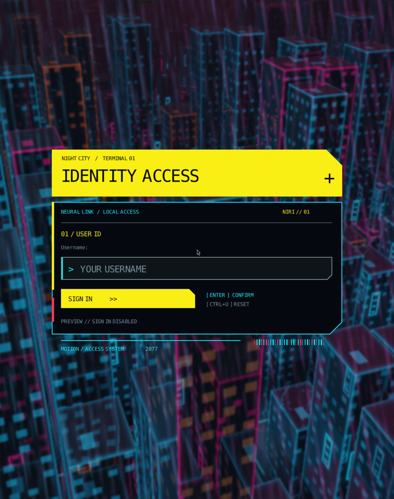

# motion-login

> **All AI — a personal experiment.** Built and configured with coding agents as a personal test. Experimental code: use at your own risk. Upstream code/assets retain their original attribution and licenses.
>
> **The year of the Linux desktop: coding agents let you configure everything. BUT: use at your own risk — agent in YOLO mode.**

## Building the complete project set

See the [shared checkout, dependency, build-order and Arch installation guide](../README.md). The checkout needs sibling `motion-render` sources and `niri-motion-background` shader/license assets. Cargo builds the renderer automatically; the wallpaper binary does not need to be built or installed for this greeter. The Arch helper snapshots both sibling inputs into its source archive. Motion Lock has copied drawing code and its own renderer snapshot, so changes here do not automatically reach the lock screen.

A native Rust/Wayland greetd greeter with a cyberpunk-inspired login panel, GPU shader/video backgrounds, configurable scaling/title/colors, occasional GPU glitch effects, and PAM-based fingerprint/password authentication.

The background uses the sibling [motion-render](../motion-render/README.md) library and the shader collection from [niri-motion-background](../niri-motion-background/README.md). The UI/authentication frontend is derived from wlgreet, with its Wayland integration ported to the current SCTK stack. Login code retains its GPL license; the shared renderer remains MIT-licensed.



## Contents

- [Architecture and requirements](#architecture-and-requirements)
- [Build, check and preview](#build-check-and-preview)
- [Command-line reference](#command-line-reference)
- [Login configuration](#login-configuration)
- [Background selection and performance](#background-selection-and-performance)
- [Fingerprint and password authentication](#fingerprint-and-password-authentication)
- [Arch/CachyOS packaging](#archcachyos-packaging)
- [systemd activation, testing and rollback](#systemd-activation-testing-and-rollback)
- [Environment and troubleshooting](#environment-and-troubleshooting)
- [Development tests and licenses](#development-tests-and-licenses)

## Architecture and requirements

Keep the three source directories next to one another:

```text
linux/
├── motion-render/            # shared EGL/GLSL/image/video/runtime library
├── niri-motion-background/   # wallpaper CLI and shader assets
└── motion-login/             # greeter UI, greetd worker and supervisor
```

The supervisor runs two children: the layer-shell login interface and an independent background-renderer process. It terminates/reaps both when the UI exits or receives a termination request. If the background exits, the login panel remains available. A real successful session handoff makes the UI exit; the packaged wrapper then quits the dedicated greeter compositor so greetd can start the authenticated user session.

The UI uses `wayland-client` 0.31 and Smithay Client Toolkit 0.21, with OpenGL through glow 0.18 and configuration through TOML 1.1. Exact dependencies are locked in `Cargo.lock`. One EGL display/context presents the panel across its outputs. Cached raster drawing is event-driven; the short GPU glitch has a roughly 30 FPS ceiling rather than a continuous render loop.

Build requirements: a current stable Rust toolchain, C linker, `pkg-config`, Wayland/EGL/OpenGL 3.3 libraries and libxkbcommon. Preview additionally requires niri and a working desktop Wayland session. Production login requires greetd and a dedicated layer-shell compositor. Fingerprint support requires fprintd/libfprint, supported hardware and an enrolled finger. Video backgrounds additionally require libmpv, normally provided by `mpv` on Arch.

On Arch/CachyOS, with Rust/Cargo already available:

```sh
sudo pacman -S --needed base-devel pkgconf wayland libglvnd libxkbcommon
```

The Arch package resolves runtime dependencies, including greetd, fprintd and niri, when installed. Noctalia is part of the user's normal niri session; it is not started inside the greeter compositor.

## Build, check and preview

From this directory:

```sh
cargo build --release --locked
./target/release/motion-login --check --config ./login.toml --background ./background.toml
./preview.sh
```

The preview launches a separate nested niri window without `--session`. It does not import that compositor's environment into the desktop's systemd user manager, replace SDDM, or alter your desktop wallpaper service. It removes the greetd socket from the UI environment and rejects real authentication.

- **Escape** closes the preview interface.
- **Alt+Escape** closes the nested niri compositor (`Mod+Escape` in its preview config).
- **F8** triggers the glitch immediately, when enabled; this shortcut is preview-only.

Preview another login configuration:

```sh
./preview.sh /absolute/path/custom-login.toml
```

The script still uses this project's `background.toml`. To choose both files, invoke the binary explicitly, inside a suitable compositor:

```sh
./target/release/motion-login --preview --config ./login.toml --background ./background.toml
```

Using the nested preview is preferable to placing an exclusive-keyboard greeter layer directly on the desktop. Configuration is read at startup; restart the preview to apply changes. The actual fingerprint flow is exercised by a real greetd login or the mock tests, not by the no-auth preview.

## Command-line reference

```text
motion-login [--preview] [--config FILE] [--background FILE]
motion-login --check [--config FILE] [--background FILE]
```

| Option | Default / behavior |
| --- | --- |
| `--config FILE` | `/etc/motion-login/login.toml`; UI/session configuration |
| `--background FILE` | `/etc/motion-login/background.toml`; shared renderer configuration |
| `--preview` | Disable real authentication; allow running without `GREETD_SOCK` |
| `--check` | Validate both configurations and enabled background files, then exit |
| `--help`, `-h` | Print usage |

Normal mode requires `GREETD_SOCK` and a dedicated Wayland compositor started by greetd. `--check` needs no Wayland connection and performs no real authentication, GLSL compilation or hardware-decoder test. `--background-worker` and `--frontend-worker` are internal supervisor modes, not public startup commands. The public supervisor does not expose the legacy frontend's `--command` override; use the TOML `command` setting.

## Login configuration

UI keys use **camelCase**. This file is separate from the renderer's **snake_case** `background.toml`. Put top-level settings, including `title`, before any `[section]`.

```toml
command = "niri-session"
outputMode = "active"
title = "IDENTITY ACCESS"
uiScale = 1.35
scale = 1

[glitch]
enabled = true
startDelaySeconds = 3
intervalSeconds = 10
durationMs = 350
strength = 0.32

[background]
red = 0.025
green = 0.035
blue = 0.065
opacity = 1.0

[headline]
red = 0.98
green = 0.94
blue = 0.08
opacity = 1.0

[prompt]
red = 0.1
green = 0.92
blue = 0.96
opacity = 1.0

[promptErr]
red = 1.0
green = 0.22
blue = 0.33
opacity = 1.0
```

### Top-level options

| Key | Schema default | Meaning / validation |
| --- | --- | --- |
| `command` | `""` | Session command; the shipped configuration explicitly sets `"niri-session"` |
| `outputMode` | `"all"` | `"all"`: panel on each output; `"active"`: one compositor-selected output. The shipped file uses `active` |
| `title` | `"IDENTITY ACCESS"` | Single-line header, up to 64 Unicode characters; control characters are rejected |
| `uiScale` | `1.35` | Logical size multiplier, finite `0.75..2.5` |
| `scale` | `1` | Wayland presentation-buffer density, integer `1..4`; independent of logical size |

The base surface is 800×580 logical design units. `uiScale = 1.35` produces a 1080×783 logical surface. Increasing `scale` increases its presentation buffer, not the logical window size or original font-rasterization resolution. The whole panel is not automatically fitted to a small monitor; choose a suitable `uiScale`.

The title is actual text rendered with rusttype using the embedded **DejaVu Sans Mono TrueType font**, not a bitmap/logo. Longer titles automatically reduce their font size to fit the header width. Unicode availability follows the embedded font. No separately installed font package is required, and font-family selection is not currently a configuration option. Other decorative captions/UI labels are fixed in source and use English; only the main header text is configurable. PAM/greetd/fprintd messages are displayed verbatim and can follow the system locale.

Set the following keys at the top of `/etc/motion-login/login.toml`, before any section headers:

```toml
defaultUser = "held"
command = "niri-session"
desktop = "niri"
sessionType = "wayland"
```

`defaultUser` defaults to an empty string (ask for the username). When set, authentication starts immediately for that user, including the fingerprint scan if enabled by PAM. This does not bypass authentication. **Ctrl+U** or **Escape** cancels the current attempt and returns to empty username entry so another user can log in. With a pending scan, cancellation waits for the current PAM response; the configured user is not automatically selected again after cancellation or failure. Preview mode never starts authentication for the default user. Usernames are not persisted automatically.

`command` is the session launch command; `desktop` defaults to `niri` and supplies both `XDG_CURRENT_DESKTOP` and `XDG_SESSION_DESKTOP`. `sessionType` defaults to `wayland` and accepts `wayland` or `x11`; `XDG_SESSION_CLASS` remains `user`. Match all three settings to the installed desktop's session launcher, for example `command = "startplasma-wayland"`, `desktop = "KDE"`, `sessionType = "wayland"` for an installed Plasma Wayland session. The greeter itself still runs in its dedicated niri compositor. These settings require the updated binary and are read when the login starts; they are not reloaded in an already-running greeter.

### Colors

Each color table contains all four floating-point channels `red`, `green`, `blue`, `opacity`; use values from `0.0` to `1.0`.

| Section | Role | Schema default |
| --- | --- | --- |
| `[background]` | Dark panel surface | Black, opacity `0.9` |
| `[headline]` | Header/action fill and highlighted text | Opaque white |
| `[prompt]` | Cyan-style outlines, labels and markers | Opaque white |
| `[promptErr]` | Error/cancel accent | Opaque white |
| `[border]` | Legacy compatibility setting; not used by the current angular panel | Opaque white |

The example/shipped file supplies the yellow/cyan/red palette instead of those schema defaults. The current panel's contour color follows `prompt`; changing the retained `border` table has no effect. Some secondary surface/text colors are currently fixed in the UI implementation. Keep opaque panel colors for predictable premultiplied-alpha composition; the silhouette's cut corners are rendered transparently.

### Glitch: `[glitch]`

| Key | Default | Meaning / accepted values |
| --- | --- | --- |
| `enabled` | `true` | Enable occasional GPU distortion |
| `startDelaySeconds` | `3` | First burst delay, `0..3600` seconds |
| `intervalSeconds` | `10` | Quiet interval after a burst or input, `5..3600` seconds |
| `durationMs` | `350` | Burst duration, `80..500` ms |
| `strength` | `0.32` | Finite `0..0.35`; `0` disables effect rendering |

The shader briefly displaces narrow horizontal bands, separates color channels and darkens the affected band. At the default strength the maximum primary displacement is about ten source pixels before UI scaling. The image returns to its undistorted state after the burst; characters/button coordinates are never changed by the shader. Input defers the next burst for a full interval. Disabled/zero-strength glitch does not schedule recurring UI effect rendering. Background animation has its own independent FPS settings.

Unknown keys in `[glitch]` are rejected. The top-level UI/color schema is less strict; use the documented key names rather than relying on unknown-key detection to catch a misplaced setting.

## Background selection and performance

[background.toml](background.toml) uses the full [motion-render configuration format](../motion-render/README.md#configuration-reference). All global power/visibility/video settings, `[[wallpapers]]` fields, `[rotation]` and `[day_night]` options described there are available.

All **28 shader variants** are listed in the login playlist. Change only the top-level selector:

```toml
active = "cyberpunk-city-rain"
```

Examples: `cyberpunk-city-flight` for the city without falling rain, `eclipse-corona` for the eclipse, `ocean-sunrise` for the sea, and `portal-turret` for the procedural turret. See the complete [shader catalog](../niri-motion-background/README.md#shader-catalog).

The shipped login profile uses 24 FPS globally, 12 on battery, scale 0.4/0.32, idle pause after 120 seconds, and a rainy-city entry capped at 20 FPS/0.32 with stabilization. Rotation, automatic day/night, fullscreen and hidden-callback pause are disabled in this login profile. Per-entry/battery caps can only reduce global limits.

To rotate every ten minutes, edit the existing block:

```toml
[rotation]
enabled = true
interval_seconds = 600
defer_while_paused = true
```

For automatic day/night in the separate greeter account, prefer `source = "schedule"`; the user's Noctalia instance is not part of this compositor. `speed`, `brightness`, `fps`, `render_scale` and `stabilize` can be tuned per shader. Images and silent videos can be added using the same schema. Video requires libmpv; entry speed/brightness and day/night color changes do not alter video playback.

Development background paths point into `../niri-motion-background/shaders/`. The package rewrites them to `/usr/share/motion-login/shaders/`, so the real login does not depend on an accessible user home directory. Restart the preview/greeter to load file changes.

## Fingerprint and password authentication

Authentication is delegated to **greetd/PAM**, not implemented by the UI or shader renderer. A worker performs serialized IPC while eventfd wakeups deliver status to the render thread. Informational/error PAM messages are acknowledged automatically; visible/secret questions accept user input. Secret input is masked and cleared using zeroize; credentials are not logged.

For supported hardware:

```sh
fprintd-enroll -f right-index-finger YOUR_USER
fprintd-verify YOUR_USER
```

The package installs [packaging/motion-login.pam](packaging/motion-login.pam) as `/etc/pam.d/motion-login`. It checks the shell, login/lockout restrictions and environment before attempting `pam_fprintd.so max-tries=3 timeout=10`, then falls through to the normal `system-local-login` password stack if fingerprint authentication does not succeed. Account, password and session policy are retained through the standard includes, with faillock account handling.

The packaged greetd configuration selects:

```toml
[general]
service = "motion-login"

[default_session]
service = "greetd"
```

The first service is for authenticating users; the second keeps startup of the greeter itself on the original greetd policy. These values belong in `/etc/motion-login/greetd.toml`, **not** UI `login.toml`. The original `/etc/pam.d/greetd` and shared system PAM files are not replaced. This integration has been checked against greetd 0.10.3.

Login flow:

1. Enter the username and press Enter/click **Sign in**.
2. If PAM requests a scan, place the enrolled finger on the sensor. Status/retry messages appear in the panel.
3. On scan failure/timeout, answer the normal password prompt. Password and fingerprint are sequential, not simultaneous.
4. Successful PAM authentication schedules `niri-session`; the greeter processes/compositor exit to complete handoff.

**Escape**, **Ctrl+U**, **Ctrl+C** or the cancel button requests cancellation. Input is disabled while verification is pending. Since greetd IPC is serial, cancellation completes when the outstanding PAM request returns; it can take the remainder of the scan timeout. A scan success received after cancellation is requested is cancelled before session startup. Wait for the cancellation acknowledgement before starting another attempt.

The dedicated PAM policy optionally integrates GNOME Keyring: password login passes the existing authentication password to the keyring and starts its daemon during session setup. Automatic unlocking requires the login keyring password to match the account password. This does not add another authentication prompt. Fingerprint login still cannot unlock a password-protected keyring, because it supplies no decryption password; a later desktop keyring prompt is not a repeated greetd login.

For password-only login with automatic keyring unlocking, remove the `auth sufficient pam_fprintd.so ...` line from `/etc/pam.d/motion-login`, retaining the password stack and optional keyring entries. Selecting `[general] service = "greetd"` also disables fingerprint authentication, but the distro's greetd policy may lack keyring integration. No fingerprint toggle in `login.toml` can override PAM policy. fprintd is D-Bus activated; no separate always-enabled fingerprint user service is needed.

### Optional TPM-backed keyring unlock after fingerprint login

A successful fingerprint login can be followed by a **GNOME Keyring unlock dialog** even though the desktop session started correctly. Fingerprint authentication supplies no password to decrypt the login keyring. The optional helpers in [tools/keyring](tools/keyring/README.txt) address this by retaining a TPM-encrypted copy of the existing keyring password and using it after successful motion-login authentication.

This is a separate, manual installation from the source tree; installing the Arch package does not enable it. It requires Python 3, GNOME Keyring, `setpriv` (util-linux), a usable TPM2, and a systemd version supporting the credential options used by the scripts (`--refuse-null` requires systemd 259 or newer). The checked machine has systemd 262 and an available TPM2. Run setup in your own terminal within the active desktop session:

```sh
cd /home/held/workspaces/linux/motion-login
systemd-analyze has-tpm2
sudo python3 tools/keyring/setup.py held
```

Replace the directory and `held` with your source location and desktop username as needed. Enter sudo's password when requested, then enter and confirm the **current login keyring password** locally. This may differ from the account password. Do not put it in command arguments or send it through chat.

Setup performs the following steps:

1. Encrypts the supplied password using `systemd-creds` with `host+tpm2` and PCR 7 binding. Only the encrypted credential is stored at `/etc/motion-login/keyring/<UID>.cred`, inside a root-only directory.
2. Installs the root-owned helper at `/usr/local/libexec/motion-login-keyring` and exercises it in the current session.
3. Saves the existing PAM policy as `/etc/pam.d/motion-login.before-tpm-keyring` if that backup does not already exist, then appends this optional session hook to `/etc/pam.d/motion-login`:

   ```text
   session optional pam_exec.so quiet /usr/local/libexec/motion-login-keyring
   ```

The hook must follow `session include system-local-login`, which sets up the user runtime directory. On session opening, the helper decrypts the credential as root, drops to the authenticated user's UID/groups, and passes the password through standard input to `gnome-keyring-daemon --unlock`. It does not write the plaintext password to disk, command arguments, or logs; the plaintext does briefly exist in process memory.

No display-manager restart is needed. Log out normally and sign in with the fingerprint to check whether the desktop starts without a keyring prompt. Setup's exit status alone does **not** prove the supplied password unlocked the keyring. Syntax and mocked session guards/privilege handoff have been checked; real TPM enrollment and fingerprint login still require testing on the machine.

The TPM binds the stored credential to this machine and its boot policy; it does not verify the fingerprint. Successful PAM authentication gates the automatic unlock, including successful password login. Root can recover the retained password on this machine, and this mechanism does not protect against a compromised OS. Other keyrings with different passwords remain separate.

If TPM decryption fails, the optional hook allows login to continue and the usual keyring dialog remains available. A TPM reset, firmware/Secure Boot policy change, or changed keyring password may require running setup again. After package upgrades, check whether the added PAM hook needs to be retained when merging configuration changes.

To undo the integration, remove the session line referring to `/usr/local/libexec/motion-login-keyring` from `/etc/pam.d/motion-login` using `sudoedit`. Then delete `/etc/motion-login/keyring/<UID>.cred` to stop retaining the encrypted password; use `id -u USERNAME` to find the correct UID (1000 for `held` on the checked machine). The helper can also be removed once no PAM policy refers to it. Use the saved PAM backup for reference; restoring it wholesale would also discard later PAM edits. No keyring password change or deletion of the user's keyrings is needed.

The no-auth preview never verifies a real finger. Unit/mock tests cover the protocol; real PAM/device/session behavior must also be tested at the actual login.

## Arch/CachyOS packaging

Build from the source directory:

```sh
./packaging/arch/build-package.sh --noconfirm
sudo pacman -U ./dist/arch/motion-login-0.3.0-14-x86_64.pkg.tar.zst
```

The helper assembles a checksummed local source archive containing the login/library sources and required wallpaper assets, then runs `makepkg --nodeps --force`. Build tools must already be present; runtime dependencies are resolved by pacman during installation. Cargo uses lockfiles. The PKGBUILD runs unit/configuration checks and niri validation. The Rust library is linked into the executable; no standalone `motion-render` package is needed.

| Installed path | Purpose |
| --- | --- |
| `/usr/bin/motion-login` | Supervisor/UI/background worker executable |
| `/usr/lib/motion-login/greeter-session` | Runs the UI and quits the greeter compositor on exit |
| `/usr/share/motion-login/shaders/` | Background shader assets |
| `/etc/motion-login/login.toml` | Title, colors, scale, glitch, session command |
| `/etc/motion-login/background.toml` | Playlist, renderer, power and video options |
| `/etc/motion-login/greetd.toml` | VT, compositor command/user and PAM service selection |
| `/etc/motion-login/greeter.kdl` | Dedicated niri greeter compositor |
| `/etc/pam.d/motion-login` | Fingerprint-first policy with password fallback |
| `/usr/lib/systemd/system/greetd.service.d/motion-login.conf` | Runs greetd with this project's config |
| `/usr/share/doc/motion-login/` | README and installation guide |
| `/usr/share/licenses/motion-login/` | Code, fonts and shader notices |

Five configuration files are marked for pacman backup handling: the four files under `/etc/motion-login` and the dedicated PAM policy. Modified local files can produce `.pacnew` files during upgrades; merge changes, especially new PAM `service` selectors. The package supplies `greetd-greeter` and does not conflict with SDDM. It never enables/stops services automatically.

## systemd activation, testing and rollback

The integration uses the existing **`greetd.service`**, not a second independently managed login daemon. Package installation alone does not switch display managers.

Validate installed files:

```sh
motion-login --check --config /etc/motion-login/login.toml --background /etc/motion-login/background.toml
niri validate --config /etc/motion-login/greeter.kdl
systemctl cat greetd.service
```

The supplied greeter compositor is separate from the user's normal niri config. It has no terminal/launcher or arbitrary command bindings. Its startup command invokes the system-owned wrapper. The preview compositor config is for development only and is not the production configuration.

For a first real test, **log out of the desktop normally**, switch to a text console with Ctrl+Alt+F3 and log in there. Keep SDDM enabled for boot while testing:

```sh
sudo systemctl stop sddm.service
sudo systemctl start greetd.service
```

The new login uses VT1 (Ctrl+Alt+F1). Test fingerprint/password login, the niri/Noctalia session, keyring behavior and the user's wallpaper service. The packaged `[terminal] vt = 1` matches the distro service's tty1 conflict; changing the VT also requires reviewing the service's TTY/getty settings.

If the test fails, return to the text console:

```sh
sudo systemctl stop greetd.service
sudo systemctl start sddm.service
journalctl -b -u greetd.service
```

Only after a successful test, change future boot activation:

```sh
sudo systemctl disable sddm.service
sudo systemctl enable --force greetd.service
```

These commands deliberately omit `--now`, so they do not terminate a working desktop session. SDDM can remain installed as a fallback. For a permanent rollback, log out, use a text console, stop/disable greetd, then enable/start SDDM:

```sh
sudo systemctl stop greetd.service
sudo systemctl disable greetd.service
sudo systemctl enable --force sddm.service
sudo systemctl start sddm.service
```

If removing the package, restore the desired display-manager activation first. Removing the drop-in makes any remaining greetd installation use its own configuration again. See [packaging/arch/INSTALL.md](packaging/arch/INSTALL.md) for the separate installation guide.

## Environment and troubleshooting

| Variable | Use |
| --- | --- |
| `GREETD_SOCK` | Provided by greetd for real authentication; removed from the preview UI |
| `WAYLAND_DISPLAY`, `XDG_RUNTIME_DIR` | Wayland connection/runtime directory |
| `RUST_LOG` | Renderer-worker logging filter |
| `MOTION_LOGIN_PREVIEW` | Internal UI flag set by `--preview` |
| `MOTION_RENDER_SOCKET` | Background IPC selector; supervisor assigns a per-process filename |
| `NIRI_SOCKET` | Removed from the background worker to avoid desktop fullscreen tracking |

The background uses its own `motion-login-<supervisor-pid>.sock`, so it does not compete with the desktop wallpaper daemon. Do not start a second independent instance using the same socket name.

| Symptom | Check |
| --- | --- |
| `GREETD_SOCK missing` | Use `--preview` on the desktop, or start real login through greetd |
| A config/source file is missing | Pass both development paths explicitly, or check system package installation |
| Custom title does not appear | Upgrade the binary, put `title` before all section headers and restart the preview/greeter |
| Panel too small/large | Adjust `uiScale`; `scale` controls buffer density instead |
| Border color seems unchanged | The angular panel uses `prompt`; `border` is a legacy no-op |
| No glitch visible | Check `enabled`/`strength`, wait after input, or press F8 in preview |
| No fingerprint prompt | Check enrollment/verify, fprintd, installed PAM profile and the greetd `general.service` setting / `.pacnew` |
| Password follows after a delay | Expected serial fingerprint-first behavior and the PAM scan timeout |
| Cancel is not immediate | Pending greetd/PAM reply must complete before serialized cancellation |
| Desktop session does not start | Inspect greetd journal, `command`, niri-session and an already-running user niri session |
| Background stops but login remains | Inspect renderer logs, local asset paths, shader compilation or optional libmpv/decoder support |
| Keyring requests a password | Fingerprint authentication does not provide its decryption password |

Apply real greeter changes after logging out; restarting the active display manager can end its current desktop session.

## Development tests and licenses

```sh
cargo test --locked
cargo clippy --all-targets -- -D warnings
cargo fmt --check
cargo test --manifest-path ../motion-render/Cargo.toml --locked
```

Live/nested tests require niri, a desktop Wayland session and a release build:

```sh
python3 tests/preview_smoke.py
MOTION_TEST_GLITCH=1 python3 tests/preview_smoke.py
# Requires Python Pillow; compares actual GPU frames before/during/after a burst:
python3 tests/glitch_visual.py
# Requires wtype; uses only synthetic credentials against a mock greetd socket:
WTYPE=/usr/bin/wtype python3 tests/input_smoke.py
```

The input test covers Unicode/backspace, fingerprint Info/Error acknowledgements, password fallback, rejection/cancellation, late-success rejection and successful mock fingerprint handoff with the correct session environment. It does not verify real credentials or start a real user session. The preview smoke checks rendering and child cleanup. The glitch comparison checks visible distortion and exact restoration of the opaque panel interior. Hardware tests remain necessary for real fingerprint/PAM/session behavior, other GPUs and physical monitor hotplug.

For a current stable-release comparison of direct Rust dependencies across the full three-project workspace:

```sh
python3 tools/audit-dependencies.py
```

This queries crates.io and writes [dependency-audit.json](dependency-audit.json). It is a version comparison, not a vulnerability scan. Transitive dependencies may legitimately retain different compatible major versions.

Login code is covered by [LICENSE](LICENSE), derived from wlgreet's GPL-3.0 license. The renderer's MIT license does not relicense the login application. Embedded fonts retain their [bundled license notices](fonts/). Shader assets retain their own [attribution and license terms](../niri-motion-background/THIRD_PARTY.md), including noncommercial/share-alike terms where stated; no original game models, textures or audio are required by the procedural scenes.
